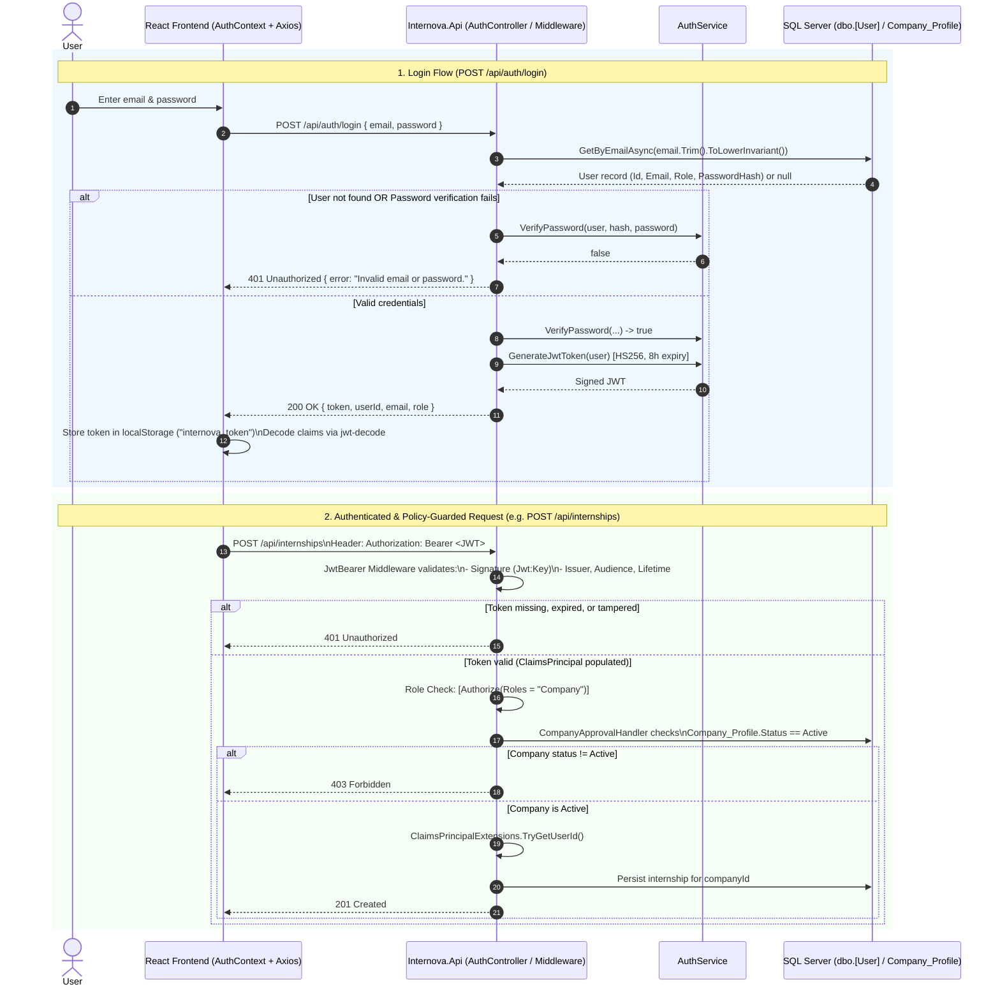
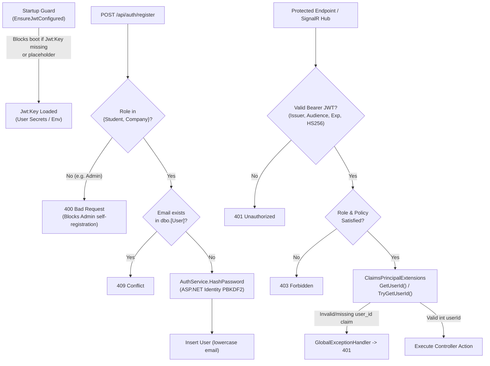

# Authentication (Login) & Secured Access Architecture

## Overview

Internova secures user authentication and API authorization using **salted password hashing** (`PasswordHasher<User>`), **stateless HMAC-SHA256 JWT Bearer tokens**, **Role-Based Access Control (RBAC)**, and **policy-based authorization** (`RequireCompanyApproval`).

---

## End-to-End Authentication & Request Flow

---

## Security Controls & Token Lifecycle

---

## JWT Claims & Token Configuration

| Claim | Source | Purpose |
|---|---|---|
| `user_id` | `user.Id.ToString()` | Primary numeric user identifier extracted by `ClaimsPrincipalExtensions` and `NotificationHub` |
| `ClaimTypes.Email` & `email` | `user.Email` | User email address |
| `ClaimTypes.Role` | `user.Role` | Enforces `[Authorize(Roles = "...")]` (`Student`, `Company`, `Admin`) |
| `sub` | `user.Id.ToString()` | Standard JWT subject claim |
| `jti` | `Guid.NewGuid()` | Unique token identifier |
| `exp` | `DateTime.UtcNow.AddHours(8)` | 8-hour token expiration enforced via `ValidateLifetime = true` |

---

## Key Security Properties Implemented

1. **Startup Fail-Fast Secret Guard**: `EnsureJwtConfigured()` in [ServiceCollectionExtensions.cs](file:///C:/Users/sandi/Documents/Internova/internova-backend/Internova.Api/Presentation/Extensions/ServiceCollectionExtensions.cs) prevents the API from starting if `Jwt:Key` is missing or left as a template placeholder.
2. **Account Enumeration Prevention**: `AuthController.Login` returns the exact same `401 Unauthorized` (`"Invalid email or password."`) whether the email does not exist or the password is wrong.
3. **Privilege Escalation Prevention**: `AuthController.Register` restricts self-registration strictly to `Student` and `Company` roles; `Admin` accounts cannot self-register.
4. **Password Hashing**: `AuthService` uses ASP.NET Core Identity's `PasswordHasher<User>` (salted PBKDF2 with SHA-256/SHA-512 depending on format version).
5. **Authorization Policies**: Beyond role checks, [CompanyApprovalRequirement.cs](file:///C:/Users/sandi/Documents/Internova/internova-backend/Internova.Api/Presentation/Authorization/CompanyApprovalRequirement.cs) enforces that a `Company` must have `CompanyStatus.Active` in `dbo.Company_Profile` before creating internships (`[Authorize(Roles = "Company", Policy = "RequireCompanyApproval")]`).
6. **Sanitized Error Responses**: [GlobalExceptionHandler.cs](file:///C:/Users/sandi/Documents/Internova/internova-backend/Internova.Api/Presentation/Middleware/GlobalExceptionHandler.cs) catches unhandled exceptions centrally, logging full details server-side while returning a generic `{ "error": "Internal server error" }` to clients (and `401` on `UnauthorizedAccessException`).
7. **SignalR Authentication**: [NotificationHub.cs](file:///C:/Users/sandi/Documents/Internova/internova-backend/Internova.Api/Presentation/Hubs/NotificationHub.cs) requires `[Authorize]` and isolates real-time notification delivery to per-user groups (`User_{userId}`).
