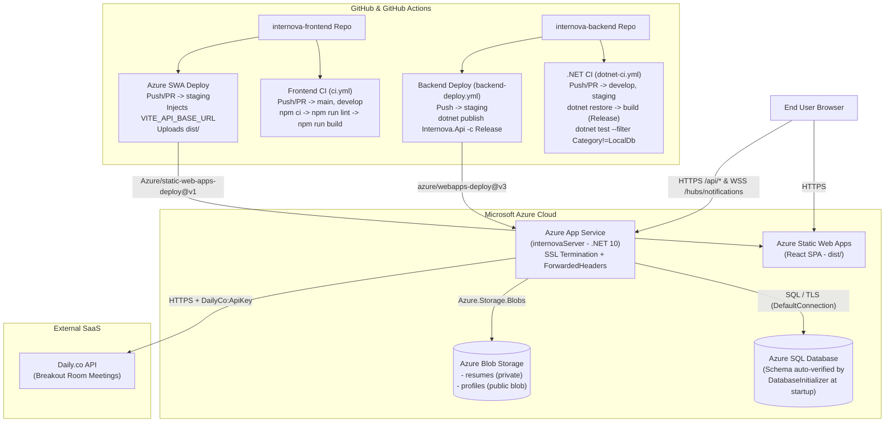
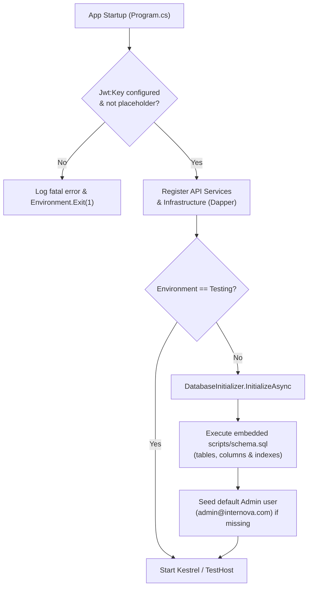

# Deployment Architecture

## Overview

Internova uses separate repositories and CI/CD pipelines for the frontend and backend, deploying to **Azure Static Web Apps** and **Azure App Service** respectively, backed by **Azure SQL Database**, **Azure Blob Storage**, and **Daily.co**.

---

## CI/CD & Cloud Deployment Diagram

---

## Environment Comparison (Local Development vs. Azure Staging/Production)

| Component | Local Development | Azure Cloud (`staging` / Production) |
|---|---|---|
| **Frontend Host** | Vite dev server (`http://localhost:5173`) with `/api` proxy to `http://localhost:5128` | Azure Static Web Apps (`dist/`) with `VITE_API_BASE_URL` set to `https://internovaserver-bcc5adh0bqbtbjdv.eastasia-01.azurewebsites.net` |
| **Backend Host** | Kestrel (`http://localhost:5128` / `https://localhost:7044`) | Azure App Service (`internovaServer`, East Asia) behind reverse proxy SSL termination |
| **CORS Policy** | `ViteDev` (`localhost:5173`, `localhost:5174`, `localhost:5128`) | `DeployedCorsPolicy` (`AllowedOrigins` array from App Settings) |
| **HTTPS Redirection** | Disabled when `ASPNETCORE_ENVIRONMENT=Development` | Enabled (`app.UseHttpsRedirection()` + `UseForwardedHeaders`) |
| **Database** | Local SQL Server / SQLEXPRESS (`appsettings.Development.json`) | Azure SQL Database via App Service Connection Strings |
| **Secrets** | `.NET User Secrets` (`internova-api-secrets`) | Azure App Service Application Settings / Connection Strings |

---

## Startup & Database Bootstrap Flow

When the backend starts on Azure App Service (or locally), `Program.cs` executes the following sequence before accepting traffic:

---

## Required Runtime Configuration

| Key | Purpose | Where Configured |
|---|---|---|
| `ConnectionStrings:DefaultConnection` | SQL Server / Azure SQL connection string | `appsettings.Development.json` / Azure Connection Strings |
| `Jwt:Key` | 32+ char symmetric HMAC-SHA256 signing key | `dotnet user-secrets` / Azure App Settings |
| `Jwt:Issuer` | Token issuer (`Internova`) | `appsettings.json` / User Secrets |
| `Jwt:Audience` | Token audience (`InternovaUsers`) | `appsettings.json` / User Secrets |
| `AzureBlob:ConnectionString` | Azure Storage account connection string | User Secrets / Azure App Settings |
| `AzureBlob:ContainerName` | Resume container name (default `resumes`) | `appsettings.json` |
| `DailyCo:ApiKey` | Daily.co API key (falls back to mock URL if empty) | User Secrets / Azure App Settings |
| `AllowedOrigins` | Allowed frontend origins in non-dev environments | Azure App Settings (`AllowedOrigins__0`, etc.) |
