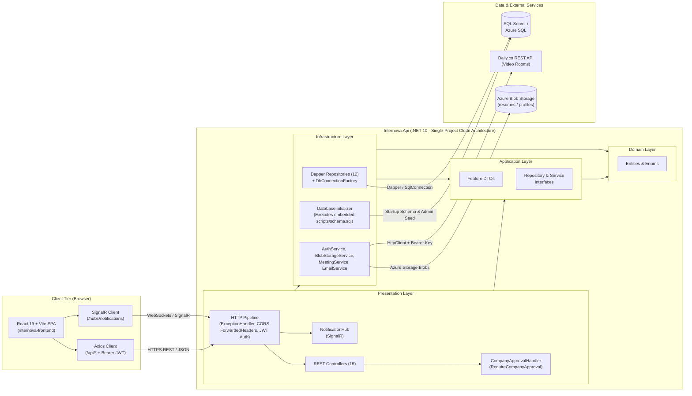
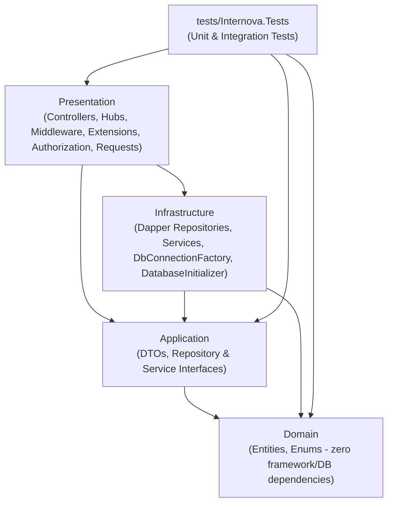

# System Architecture

## Overview

**Internova** is a university internship and industry matching portal composed of a React single-page application (`internova-frontend`) and a .NET 10 ASP.NET Core Web API (`internova-backend`) structured with **single-project Clean Architecture**, backed by SQL Server / Azure SQL, Azure Blob Storage, Daily.co, and SignalR real-time notifications.

---

## High-Level System Architecture

---

## Single-Project Clean Architecture Dependency Rule

Inside `Internova.Api`, dependencies flow strictly inward toward `Domain`:

---

## Request Processing Pipeline (`Internova.Api`)

Every incoming HTTP request traverses the middleware pipeline configured in `Internova.Api/Program.cs`:

```mermaid
flowchart LR
    Req["Incoming Request"] --> Ex["UseExceptionHandler\n(GlobalExceptionHandler)"]
    Ex --> Swag["Swagger UI\n(/swagger)"]
    Swag --> Fwd["UseForwardedHeaders\n(X-Forwarded-For / Proto)"]
    Fwd --> Https["UseHttpsRedirection\n(Non-Dev only)"]
    Https --> Cors["UseCors\n(ViteDev / DeployedCorsPolicy)"]
    Cors --> AuthN["UseAuthentication\n(JWT Bearer)"]
    AuthN --> AuthZ["UseAuthorization\n(Roles & RequireCompanyApproval)"]
    AuthZ --> Route["Controllers (/api/*)\n& SignalR (/hubs/notifications)"]
```

---

## Core Functional Modules

| Module | Controller | Repository / Service | Key Tables |
|---|---|---|---|
| **Authentication & Account** | `AuthController` | `IUserRepository`, `IAuthService` | `[User]` |
| **User & Student Profiles** | `ProfilesController`, `StudentsController`, `SettingsController` | `IUserRepository`, `IStudentProfileRepository`, `IBlobStorageService` | `[User]`, `Student_Profile` |
| **Company & Admin Approvals** | `AdminCompaniesController`, `AnalyticsController` | `ICompanyProfileRepository`, `IInternshipRepository`, `IAnalyticsRepository` | `Company_Profile`, `Internship`, `Internship_Application` |
| **Internships & Applications** | `InternshipsController`, `ApplicationsController`, `InterviewsController` | `IInternshipRepository`, `IInternshipApplicationRepository`, `IInterviewRepository` | `Internship`, `Internship_Application`, `Interview` |
| **Competitions & Projects** | `CompetitionsController`, `ProjectsController` | `ICompetitionRepository`, `IProjectRepository` | `Competition`, `Project`, `Project_Participation` |
| **Seminars & Breakout Rooms** | `SeminarsController`, `BreakoutRoomsController` | `ISeminarRepository`, `IBreakoutRoomRepository`, `IMeetingService`, `IEmailService` | `Seminar_Request`, `Seminar_Vote`, `BreakoutRoom` |
| **Notifications & Health** | `NotificationsController`, `NotificationHub`, `HealthController` | `INotificationRepository` | `Notification` |
